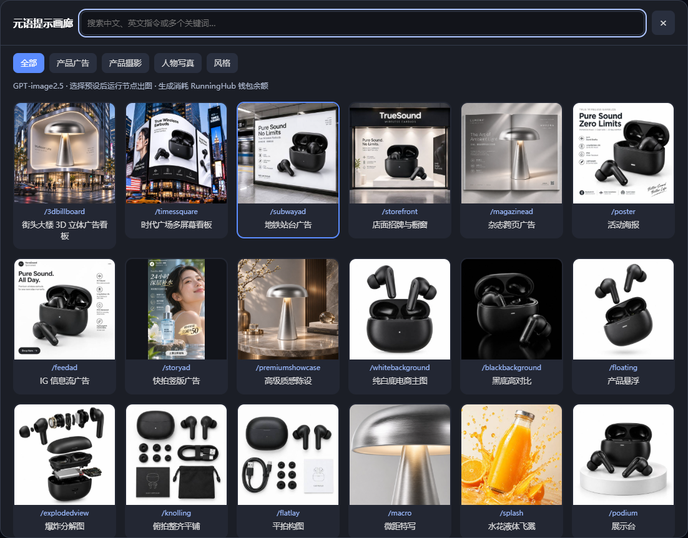
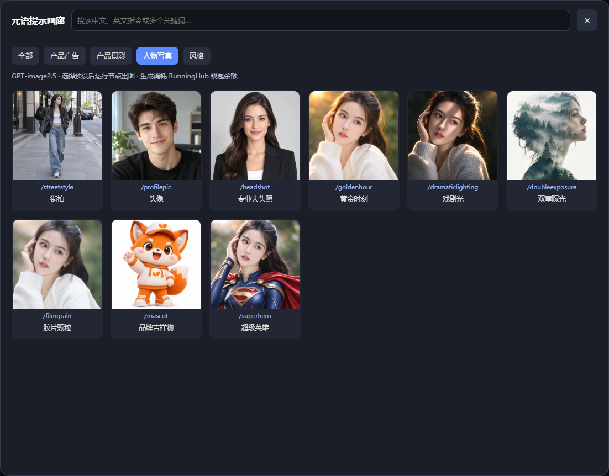

# Ajie Gallery｜阿杰画廊

**在 ComfyUI 里看着样图选预设，再用自己的素材出图。** 阿杰画廊把 200 个预设做成了可以翻看的卡片，分为产品广告、产品摄影、人物写真和风格四类。点中一张卡片，对应的提示词就会填回节点，运行时交给 RunningHub 的 GPT-image2.5 生成。

## 拿一张商品图，试两种拍法

假设你手上有一张耳机产品图。把它接到画廊节点的 `image_1`，在搜索框输入「地铁站台广告」或 `/subwayad`，选中卡片，就能用这张产品图尝试一张站台广告。想换成电商主图，可以保留同一张参考图，改选「纯白底主图」。两次用的是同一件商品，改变的是画面要呈现的场景。

拍人像时也可以这样选。在「人物写真」里，对照「黄金时刻」「戏剧光」「双重曝光」的样图挑方向。下图是插件在本地浏览器中的实际界面，卡片缩略图用于预览风格。

## 在工作流里使用

1. 添加 **元语提示画廊 · GPT-image2.5 (RH)** 节点，点击「打开元语提示画廊」，选择一张卡片。
2. **文生图**可以直接选预设。**图生图**把素材接到 `image_1` 至 `image_8`，按插口顺序传给模型。可以只接一张。
3. 选择画幅和分辨率（1K、2K 或 4K），将 `image` 输出接到「预览图像」或「保存图像」，然后运行。`prompt` 输出可以查看这次使用的预设短语。

浏览和选卡免费。运行生成会调用 RunningHub GPT-image2.5 Economy，并消耗钱包余额。默认使用 `sunburst`，也可以切换到 `flare`。

**直接从示例开始：** [文生图工作流](examples/01-text-to-image.json) · [图生图工作流](examples/02-image-to-image.json)。将 JSON 拖入 ComfyUI 编辑器即可打开，图生图示例需要先在「加载图像」节点选择自己的素材。

预设和缩略图沿用 SynVow 原画廊素材，本项目未对这些素材另行授予开源许可。
